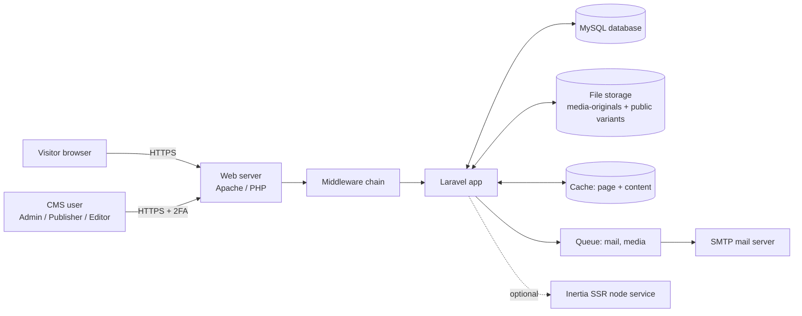
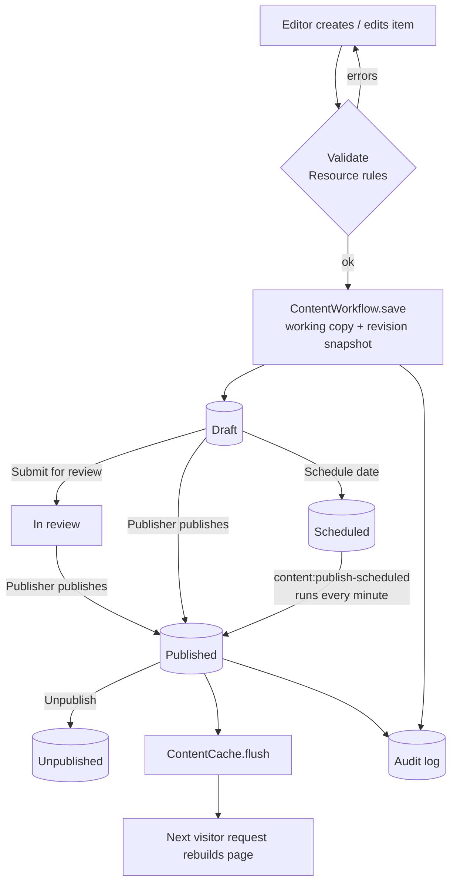
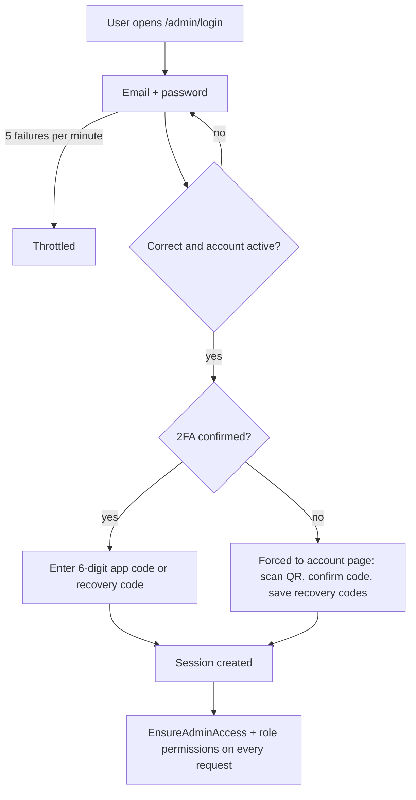
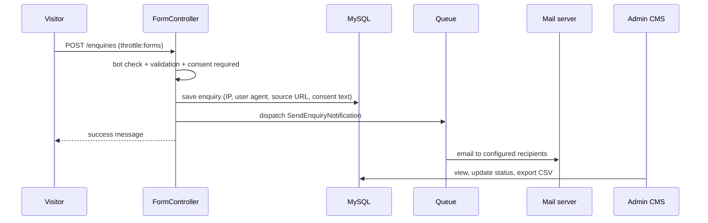
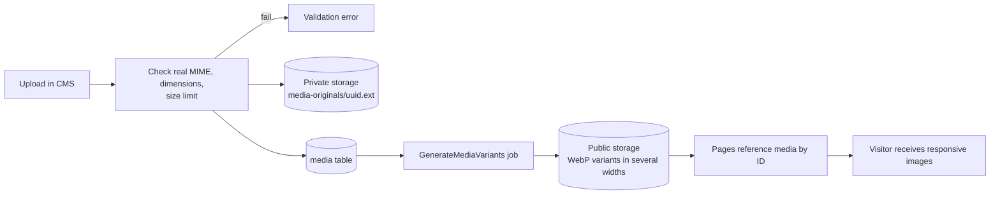
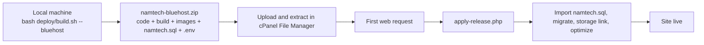

# NAMTECH Website: Data Flow Document

Stack: Laravel 13 (PHP 8.3) backend, Inertia + React frontend, MySQL (SQLite on demo hosts), file storage on disk. Diagrams use Mermaid and render on GitHub.

## 1. System overview



| Part | Responsibility |
|---|---|
| React frontend (`frontend/src`) | Pages, components, styles. Built by Vite into `backend/public/build`. |
| Laravel backend (`backend/app`) | Routing, CMS, validation, security, rendering page data. |
| MySQL | All content, settings, users, enquiries, audit log, revisions. |
| File storage | Original uploads (private) and generated image variants (public). |
| Cache | Rendered public pages and shared site data (menus, settings). |
| Queue and scheduler | Email notifications, image variants, scheduled publishing. |

## 2. Public request flow (visitor reads a page)

```mermaid
sequenceDiagram
    participant B as Browser
    participant S as SecurityHeaders / HideDisabledModules
    participant R as HandleRedirects
    participant I as HandleInertiaRequests
    participant P as CachePublicPages
    participant C as SiteController
    participant D as PublicRenderer / SectionPresenter
    participant DB as MySQL
    B->>S: GET /programs/btech-robotics
    S->>S: add headers; 404 if module switched off
    S->>R: continue
    R->>R: apply redirect table
    R->>I: continue
    I->>I: attach shared data (menus, settings, announcements)
    I->>P: continue
    alt cached copy exists (guests only)
        P-->>B: cached HTML or Inertia JSON
    else miss
        P->>C: route to controller
        C->>DB: load published record + sections
        C->>D: build page props
        D->>D: drop hidden sections, hidden blocks, hidden items
        D-->>P: Inertia response
        P->>P: store in cache
        P-->>B: HTML (first load) or JSON (later navigation)
    end
```

Key rules:
- Only records with status `published` are returned to visitors.
- A section with `is_visible = false` is removed in `SectionPresenter`. Blocks listed in `hidden_blocks` and items marked hidden are removed too.
- An empty section shows `SAMPLE –` placeholder content (`SampleContent`) instead of disappearing.
- Modules switched off in Settings return 404, vanish from menus and the sitemap (`HideDisabledModules`, `Menu::tree`, `SitemapController`).
- Logged-in users and admin routes are never cached.
- Cache is invalidated by bumping a version key (`ContentCache::flush`) whenever content, menus or settings are saved.

## 3. CMS content flow (editor to visitor)



- Roles: **Super Admin** (everything), **Publisher** (edit, submit, publish, delete, media, navigation, redirects, enquiries), **Editor** (edit, submit, media).
- Every save keeps a revision, so an older version can be restored.
- Previews (`/admin/preview/...`) show the working copy without publishing.
- Show/hide controls: item status (publish / unpublish), page-section switch, per-block checklist, header/footer toggles, whole-module toggles under Settings.

## 4. Admin sign-in flow (with 2-step verification)



2FA is required for all three roles (`ADMIN_ENFORCE_2FA=true`). Admin pages are sent with `no-store` and `noindex` headers.

## 5. Form submission flow (enquiry, newsletter, job application)



The same pattern applies to newsletter sign-up (with unsubscribe token link) and job applications (resume file stored privately, downloadable only by admins).

## 6. Media flow



Originals are never served directly. Pages reference media by ID, and `media_usages` tracks where each file is used.

## 7. Background jobs and schedule

| Task | Frequency | Effect |
|---|---|---|
| `content:publish-scheduled` | every minute | Publishes items whose scheduled time has passed. |
| `queue:work` (mail, media, default) | continuous on server, or via scheduler on shared hosting | Sends emails, builds image variants. |
| `queue:prune-failed` | daily | Removes failed jobs older than 30 days. |
| `auth:clear-resets` | hourly | Removes expired password-reset tokens. |

## 8. Main data stores

| Group | Tables / models |
|---|---|
| Pages and sections | `pages`, `page_sections` |
| Academics | `programs`, `schools`, `centres`, `faculty` |
| Editorial | `posts`, `categories`, `tags`, `authors`, `events`, `publications`, `galleries`, `gallery_items`, `initiatives`, `statistics`, `announcements` |
| Partnerships and people | `partners`, `partnership_categories`, `leaders`, `job_openings` |
| Navigation and SEO | `menus`, `menu_items`, `redirects` |
| Media | `media`, `media_usages` |
| Leads (private) | `enquiries`, `job_applications`, `newsletter_subscribers` |
| Platform | `users`, roles and permissions tables, `settings`, `content_revisions`, `audit_logs`, `cache`, `sessions`, `jobs` |

Personal data (names, emails, phone numbers, IP addresses, resumes) is held only in the leads tables and private storage. These are visible to users with the enquiries permission and are not included in the exported Bluehost database (structure only).

## 9. Security controls on each flow

| Control | Where |
|---|---|
| HTTPS redirect, HSTS | `.htaccess`, `SecurityHeaders` |
| Content Security Policy, X-Frame-Options, nosniff, Referrer-Policy, Permissions-Policy | `SecurityHeaders` |
| Rate limits: login 5/min, forms, search 30/min, admin 240/min | `AppServiceProvider`, `FortifyServiceProvider` |
| CSRF tokens and encrypted sessions | Laravel defaults, `SESSION_ENCRYPT=true` |
| Input validation and HTML sanitising | `Resource` rules, `HtmlSanitizer`, `SafeUrl` rule |
| Role permissions, active-account check, 2FA | `EnsureAdminAccess`, `Permission` / `Role` enums |
| Audit trail of admin actions | `AuditLogger`, `audit_logs` |
| Secrets (`APP_KEY`, DB password) | `.env` only, never committed |
| Hidden files and server folders blocked | `.htaccess` deny rules |

## 10. Deployment data flow (Bluehost)



The release hook runs only when `release.txt` changes, and logs to `storage/logs/deploy.log`.
